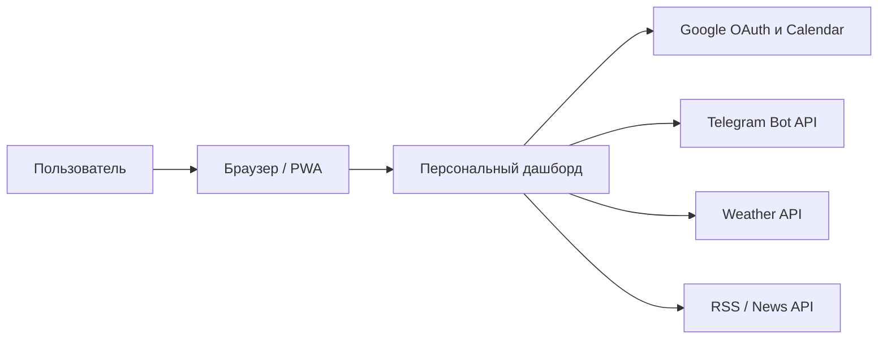
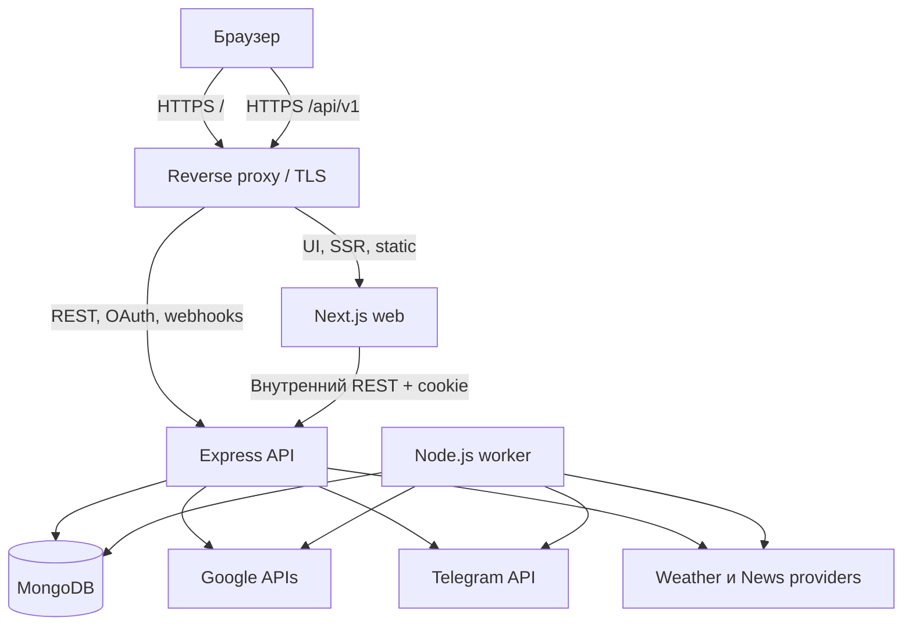
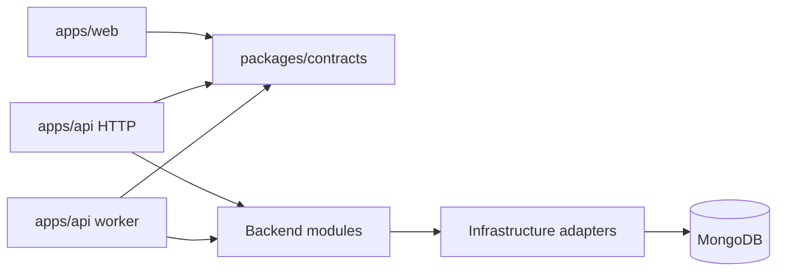
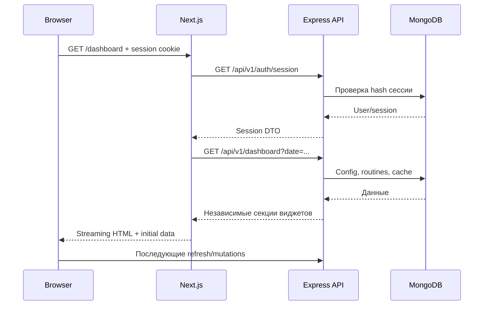
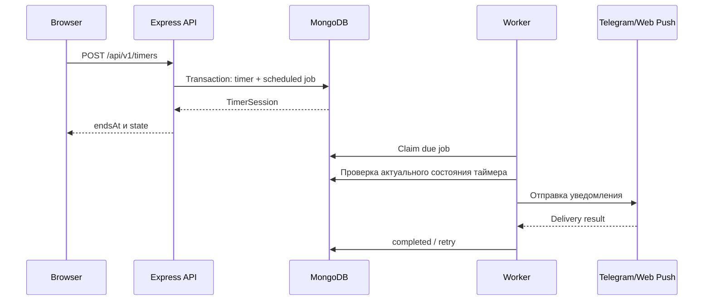
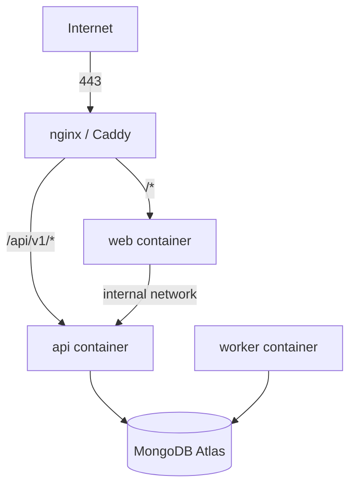

# Архитектура персонального дашборда

Версия: 1.0  
Статус: целевая архитектура MVP  
Основание: [TECHNICAL_SPECIFICATION.md](./TECHNICAL_SPECIFICATION.md)

## 1. Архитектурное резюме

Приложение строится как monorepo и состоит из трёх независимо запускаемых процессов:

1. `web` — React + Next.js + TypeScript + SCSS.
2. `api` — Node.js + Express + TypeScript.
3. `worker` — второй процесс из той же кодовой базы Express backend для фоновых и отложенных задач.

MongoDB является единственным постоянным источником истины. На MVP Redis не обязателен. Reverse proxy предоставляет единый публичный origin и направляет `/api/v1/*` в Express, а остальные запросы — в Next.js.

Основной архитектурный стиль backend — модульный монолит. Это даёт явные границы между доменами без операционной сложности микросервисов.

Ключевые решения:

- один репозиторий и один lock-файл;
- npm workspaces, так как проект уже использует npm;
- отдельные Docker-образы для `web` и `api`;
- один backend-образ запускается двумя командами: API и worker;
- Next.js не обращается к MongoDB напрямую;
- бизнес-логика находится только в backend-модулях;
- frontend и backend используют общие API-контракты, но не общие модели БД;
- фоновые задачи сначала хранятся в MongoDB;
- production-развёртывание начинается с Docker Compose на одном сервере и MongoDB Atlas;
- возможность горизонтального масштабирования сохраняется без внедрения Kubernetes и микросервисов на старте.

## 2. Контекст системы



Система не предоставляет внешним клиентам прямой доступ к MongoDB или worker. Все пользовательские операции проходят через Express API.

## 3. Контейнерная схема



### Ответственность процессов

`web`:

- маршрутизация интерфейса;
- Server и Client Components;
- SSR и streaming;
- формы и пользовательские взаимодействия;
- SCSS Modules и темы;
- service worker для Web Push;
- вызовы Express API.

`api`:

- OAuth и сессии;
- REST API;
- валидация запросов;
- бизнес-операции;
- webhook Google и Telegram;
- доступ к MongoDB;
- постановка фоновых задач.

`worker`:

- выполнение отложенных уведомлений;
- завершение таймеров;
- синхронизация календаря;
- обновление AI-новостей;
- повторная доставка сообщений;
- очистка и восстановление зависших задач.

`MongoDB`:

- пользовательские и доменные данные;
- сессии и одноразовые токены;
- кэш внешних данных;
- очередь фоновых задач;
- идемпотентность уведомлений.

## 4. Структура репозитория

Рекомендуемая структура:

```text
dashboard/
├─ apps/
│  ├─ web/
│  │  ├─ public/
│  │  │  ├─ icons/
│  │  │  └─ sw.js
│  │  ├─ src/
│  │  │  ├─ app/
│  │  │  │  ├─ (public)/
│  │  │  │  │  ├─ login/
│  │  │  │  │  ├─ privacy/
│  │  │  │  │  └─ terms/
│  │  │  │  ├─ (protected)/
│  │  │  │  │  ├─ dashboard/
│  │  │  │  │  ├─ settings/
│  │  │  │  │  │  ├─ widgets/
│  │  │  │  │  │  ├─ routines/
│  │  │  │  │  │  ├─ integrations/
│  │  │  │  │  │  └─ profile/
│  │  │  │  │  └─ layout.tsx
│  │  │  │  ├─ error.tsx
│  │  │  │  ├─ global-error.tsx
│  │  │  │  ├─ layout.tsx
│  │  │  │  └─ not-found.tsx
│  │  │  ├─ features/
│  │  │  │  ├─ auth/
│  │  │  │  ├─ calendar/
│  │  │  │  ├─ dashboard/
│  │  │  │  ├─ news/
│  │  │  │  ├─ notifications/
│  │  │  │  ├─ routines/
│  │  │  │  ├─ timer/
│  │  │  │  ├─ weather/
│  │  │  │  └─ widget-settings/
│  │  │  ├─ components/
│  │  │  │  ├─ ui/
│  │  │  │  ├─ layout/
│  │  │  │  └─ feedback/
│  │  │  ├─ lib/
│  │  │  │  ├─ api/
│  │  │  │  ├─ auth/
│  │  │  │  ├─ browser/
│  │  │  │  └─ format/
│  │  │  ├─ providers/
│  │  │  └─ styles/
│  │  │     ├─ _breakpoints.scss
│  │  │     ├─ _mixins.scss
│  │  │     ├─ _tokens.scss
│  │  │     ├─ _typography.scss
│  │  │     └─ globals.scss
│  │  ├─ next.config.ts
│  │  ├─ package.json
│  │  └─ tsconfig.json
│  │
│  └─ api/
│     ├─ src/
│     │  ├─ main.ts
│     │  ├─ worker-main.ts
│     │  ├─ app/
│     │  │  ├─ create-app.ts
│     │  │  ├─ register-routes.ts
│     │  │  └─ shutdown.ts
│     │  ├─ config/
│     │  │  ├─ env.ts
│     │  │  └─ constants.ts
│     │  ├─ modules/
│     │  │  ├─ auth/
│     │  │  ├─ calendar/
│     │  │  ├─ dashboard/
│     │  │  ├─ integrations/
│     │  │  ├─ news/
│     │  │  ├─ notifications/
│     │  │  ├─ routines/
│     │  │  ├─ timer/
│     │  │  ├─ users/
│     │  │  ├─ weather/
│     │  │  └─ widgets/
│     │  ├─ infrastructure/
│     │  │  ├─ crypto/
│     │  │  ├─ http-clients/
│     │  │  ├─ jobs/
│     │  │  ├─ logging/
│     │  │  ├─ mongodb/
│     │  │  └─ push/
│     │  ├─ middleware/
│     │  ├─ shared/
│     │  │  ├─ errors/
│     │  │  ├─ types/
│     │  │  └─ utils/
│     │  └─ tests/
│     ├─ migrations/
│     ├─ package.json
│     └─ tsconfig.json
│
├─ packages/
│  ├─ contracts/
│  │  ├─ src/
│  │  │  ├─ auth/
│  │  │  ├─ common/
│  │  │  ├─ routines/
│  │  │  ├─ timer/
│  │  │  └─ widgets/
│  │  └─ package.json
│  └─ config/
│     ├─ eslint/
│     ├─ typescript/
│     └─ package.json
│
├─ infra/
│  ├─ docker/
│  │  ├─ web.Dockerfile
│  │  └─ api.Dockerfile
│  ├─ nginx/
│  │  └─ default.conf
│  ├─ compose.dev.yml
│  └─ compose.prod.yml
│
├─ scripts/
│  ├─ create-indexes.ts
│  └─ migrate.ts
├─ .env.example
├─ package.json
├─ package-lock.json
├─ TECHNICAL_SPECIFICATION.md
└─ architecture.md
```

### Почему worker находится внутри `apps/api`

API и worker используют одни и те же сервисы, repositories, интеграции и модели. Выделение отдельного `apps/worker` заставило бы либо дублировать код, либо преждевременно создавать большой общий backend-пакет.

Поэтому собирается один backend-образ, но запускается двумя командами:

```text
node dist/main.js
node dist/worker-main.js
```

Процессы остаются независимыми: их можно перезапускать и масштабировать отдельно.

## 5. Правила зависимостей

### 5.1. Общие правила

- `apps/web` не импортирует код из `apps/api`.
- `apps/api` не импортирует React/Next.js.
- Оба приложения могут импортировать только публичные API из `packages/contracts` и `packages/config`.
- `packages/contracts` не зависит от frontend, Express и MongoDB.
- MongoDB-типы документов не публикуются во frontend.
- Секреты и server-only код не размещаются в общих пакетах.

Направление зависимостей:



### 5.2. Связи backend-модулей

- Route вызывает controller.
- Controller валидирует HTTP DTO и вызывает service.
- Service содержит бизнес-логику и вызывает repository/integration.
- Repository работает с одной или несколькими коллекциями своего модуля.
- Один модуль не обращается напрямую к repository другого модуля.
- Межмодульное взаимодействие выполняется через публичный service.
- Infrastructure реализует интерфейсы внешних зависимостей.

Допустимое направление:

```text
route → controller → service → repository → MongoDB
                           ↘ integration → External API
                           ↘ job queue → MongoDB
```

Обратные импорты запрещены.

## 6. Frontend-архитектура

### 6.1. App Router

Папка `app` отвечает только за:

- URL и layouts;
- загрузку первичных данных;
- route-level loading/error/not-found states;
- composition feature-компонентов;
- metadata.

Большая бизнес-логика и сложные компоненты в `app` не размещаются.

Группы маршрутов:

- `(public)` — страницы без сессии;
- `(protected)` — маршруты, требующие авторизации.

Проверка защищённого layout выполняется на сервере через Express endpoint `GET /api/v1/auth/session`. Cookie входящего запроса пересылается во внутренний API. При отсутствии сессии Next.js выполняет redirect на `/login`.

### 6.2. Server и Client Components

Server Components применяются для:

- layouts и страниц;
- первичной загрузки dashboard;
- чтения server-only переменных;
- уменьшения клиентского JavaScript.

Client Components применяются только там, где нужны:

- React state и обработчики событий;
- таймер;
- drag-and-drop;
- Geolocation API;
- Notification API;
- анимация погоды;
- optimistic UI.

Граница `'use client'` размещается как можно ниже по дереву.

### 6.3. Feature-first организация

Каждый домен во frontend имеет локальную структуру:

```text
features/routines/
├─ api/
├─ components/
├─ hooks/
├─ model/
├─ styles/
└─ index.ts
```

Правила:

- feature экспортирует только публичные элементы через `index.ts`;
- feature может импортировать `components/ui`, `lib` и `contracts`;
- прямые циклические импорты между features запрещены;
- объединение нескольких features выполняется на уровне страницы или dashboard composition;
- универсальный UI не должен знать о routines, timer или calendar.

### 6.4. Работа с API

В `src/lib/api` находятся два клиента:

- `server-api-client.ts` — работает внутри Next.js, использует `INTERNAL_API_URL` и пересылает cookie;
- `browser-api-client.ts` — использует относительные URL `/api/v1/*`.

Оба клиента:

- добавляют `requestId`, если он отсутствует;
- обрабатывают единый формат ошибок;
- проверяют ответ runtime-схемой из `packages/contracts`;
- не повторяют автоматически изменяющие запросы без idempotency key;
- поддерживают `AbortSignal` и timeout.

Первичная загрузка `/dashboard`:

1. Server Component вызывает агрегирующий endpoint.
2. Express возвращает независимые секции виджетов.
3. Страница передаёт initial data клиентским виджетам.
4. Дальнейшие обновления и мутации идут из браузера напрямую в `/api/v1`.

Для MVP не требуется отдельная библиотека глобального server-state. Её следует добавить только при появлении повторяющейся логики кэширования, сложной пагинации или большого количества optimistic updates.

### 6.5. Стили

Обязательный подход:

- локальные стили — `Component.module.scss`;
- глобальные стили — только `styles/globals.scss`;
- Sass подключается через пакет `sass`;
- современный `@use` вместо устаревшего `@import`;
- Sass variables/mixins используются для compile-time значений;
- CSS custom properties используются для runtime-темы;
- inline styles допускаются только для действительно динамических числовых значений;
- Tailwind не используется.

Пример размещения:

```text
features/weather/components/WeatherWidget/
├─ WeatherWidget.tsx
├─ WeatherWidget.module.scss
├─ weather-animation.ts
└─ index.ts
```

Design tokens определяются один раз:

```text
styles/_tokens.scss      — Sass maps и compile-time tokens
styles/globals.scss      — CSS variables для light/dark themes
```

### 6.6. Service worker

Service worker отвечает только за:

- получение Web Push;
- отображение browser notification;
- обработку перехода по уведомлению;
- кэширование минимального app shell при необходимости.

Он не является источником истины для таймера и не содержит бизнес-правила.

## 7. Backend-архитектура

### 7.1. Модульный монолит

Каждый доменный модуль имеет одинаковую форму:

```text
modules/routines/
├─ routine.routes.ts
├─ routine.controller.ts
├─ routine.service.ts
├─ routine.repository.ts
├─ routine.contracts.ts
├─ routine.types.ts
├─ routine.errors.ts
└─ routine.service.test.ts
```

Небольшой модуль может не создавать все файлы сразу. Деление выполняется по ответственности, а не ради количества слоёв.

### 7.2. Express pipeline

Порядок middleware:

1. trusted proxy configuration;
2. request ID;
3. structured access log;
4. security headers;
5. body size limits;
6. cookie parsing;
7. CORS — только если используется отдельный origin;
8. session/authentication;
9. CSRF/origin validation для мутаций;
10. rate limiting;
11. routes;
12. not-found handler;
13. centralized error handler.

`X-Powered-By` отключается. Значение `trust proxy` задаётся согласно реальному количеству доверенных прокси, а не глобальным `true`.

### 7.3. Формат API

Публичный префикс:

```text
/api/v1
```

Успешный единичный ответ:

```json
{
  "data": {},
  "meta": {
    "requestId": "..."
  }
}
```

Ошибка:

```json
{
  "error": {
    "code": "ROUTINE_NOT_FOUND",
    "message": "Рутина не найдена",
    "fieldErrors": {}
  },
  "meta": {
    "requestId": "..."
  }
}
```

Правила:

- JSON-поля API используют единое соглашение `camelCase`;
- даты-время передаются в ISO 8601 UTC;
- локальная дата передаётся как `YYYY-MM-DD`;
- pagination — cursor-based для растущих коллекций;
- `PATCH` используется для частичных изменений;
- повторяемые POST-запросы принимают `Idempotency-Key`;
- API не возвращает MongoDB-документ напрямую;
- DTO преобразуется явно в service/controller.

### 7.4. Общие контракты

`packages/contracts` содержит:

- runtime-схемы request/response;
- выведенные из схем TypeScript-типы;
- enum/union API-статусов;
- контракт ошибок;
- только сериализуемые DTO.

Контракты не содержат:

- `ObjectId`;
- MongoDB collection types;
- Express Request/Response;
- React components;
- секреты или внутренние поля интеграций.

## 8. MongoDB

### 8.1. Подключение

- Каждый процесс создаёт один `MongoClient`.
- Внутри процесса используется общий connection pool.
- Клиент открывается при старте и закрывается при `SIGTERM`/`SIGINT`.
- API становится ready только после успешного подключения.
- На transient errors применяются ограниченные retries с exponential backoff.
- Запросы имеют разумный `maxTimeMS`.

Production MongoDB должна работать как replica set. Рекомендуемый вариант — MongoDB Atlas.

### 8.2. Коллекции

`users`:

- профиль, locale, timezone, тема;
- индекс по внешним идентификаторам не хранится здесь.

`auth_accounts`:

- OAuth/Telegram identity;
- зашифрованные токены;
- unique `{ provider: 1, providerUserId: 1 }`;
- unique `{ userId: 1, provider: 1 }`.

`sessions`:

- hash session token, `userId`, `expiresAt`;
- unique по hash;
- TTL index только по `expiresAt`.

`dashboard_configs`:

- один документ на пользователя;
- небольшой ограниченный массив настроек виджетов;
- unique `{ userId: 1 }`;
- порядок и видимость обновляются атомарно одним документом.

`routine_rules`:

- шаблоны повторений;
- индекс `{ userId: 1, status: 1 }`;
- индекс `{ userId: 1, startDate: 1 }`.

`routine_occurrences`:

- состояние рутины на конкретную локальную дату;
- unique `{ routineRuleId: 1, localDate: 1 }`;
- индекс `{ userId: 1, localDate: 1 }`.

`timer_sessions`:

- история и текущая сессия;
- индекс `{ userId: 1, startedAt: -1 }`;
- partial unique index, не допускающий более одной активной сессии пользователя.

`integrations`:

- Google Calendar и Telegram;
- credentials шифруются на уровне приложения;
- unique `{ userId: 1, type: 1 }`.

`calendar_events`:

- нормализованный пользовательский кэш;
- unique `{ integrationId: 1, externalEventId: 1 }`;
- индекс `{ userId: 1, startAt: 1 }`.

`news_items`:

- глобальный кэш новостей;
- unique по hash канонического URL;
- индекс `{ publishedAt: -1, topics: 1, language: 1 }`.

`push_subscriptions`:

- Web Push endpoint и зашифрованные ключи;
- unique по hash endpoint;
- индекс `{ userId: 1, revokedAt: 1 }`.

`scheduled_jobs`:

- тип, payload, `runAt`, status, attempts;
- lease-поля `lockedAt`, `lockedBy`, `lockExpiresAt`;
- unique `idempotencyKey`;
- индекс `{ status: 1, runAt: 1 }`;
- отдельный TTL index по `deleteAt` для завершённых задач.

`notification_deliveries`:

- канал, status, attempts, provider message ID;
- unique `idempotencyKey`;
- индекс `{ userId: 1, createdAt: -1 }`;
- TTL index по `deleteAt` согласно политике хранения.

`audit_events`:

- события безопасности;
- индекс `{ userId: 1, createdAt: -1 }`;
- TTL определяется политикой хранения.

Важно: TTL index в MongoDB является однополевым. Его нельзя совмещать с compound index.

### 8.3. Embedding и references

Встраиваются:

- небольшой ограниченный список widget preferences;
- настройки темы и локали пользователя;
- компактные значения timer preset.

Хранятся отдельно:

- история рутин;
- события календаря;
- новости;
- сессии;
- уведомления;
- фоновые задачи.

Неограниченно растущие массивы внутри `User` запрещены.

### 8.4. Транзакции

Транзакции используются только для операций, где требуется атомарное изменение нескольких документов:

- запуск таймера + создание scheduled job;
- критичное завершение OAuth-привязки;
- удаление интеграции + отмена связанных задач.

Обычные обновления одного документа используют атомарные операции MongoDB без транзакции.

## 9. Фоновые задачи

### 9.1. Почему без Redis на MVP

Отдельный Redis увеличивает количество сервисов, секретов, мониторинга и резервных сценариев. Для ожидаемой нагрузки персонального дашборда MongoDB достаточно для persistent job queue.

Взаимодействие скрывается за интерфейсом `JobQueue`. При росте нагрузки реализацию можно заменить на Redis/BullMQ без изменения доменных сервисов.

### 9.2. Получение задачи worker

Worker атомарно выполняет `findOneAndUpdate`:

- выбирает `pending` задачу с `runAt <= now`;
- устанавливает `status = processing`;
- записывает `lockedBy` и срок lease;
- возвращает захваченный документ.

После выполнения:

- успех → `completed`;
- временная ошибка → новый `runAt` с exponential backoff;
- превышение retries → `failed`;
- завершённый документ получает `deleteAt`.

Если worker завершился аварийно, задача с истёкшим lease возвращается в `pending`.

### 9.3. Идемпотентность

Каждая доставляемая операция имеет стабильный `idempotencyKey`, например:

```text
timer:{timerSessionId}:work-completed:telegram
```

Unique index не позволяет создать повторную доставку. Внешний вызов и его результат фиксируются в `notification_deliveries`.

### 9.4. Периодические задачи

- AI-новости — каждые 15 минут;
- продление Calendar watch channels — по сроку expiration;
- восстановительная Calendar sync — по расписанию;
- поиск истёкших таймеров — короткий интервал как страховочный механизм;
- очистка отозванных подписок — ежедневно;
- возврат задач с истёкшим lease — постоянно;
- проверка reminder рутин — согласно локальному времени пользователя.

Периодические задачи используют распределённый lock в MongoDB, чтобы при нескольких worker только один создавал очередную партию.

## 10. Основные потоки данных

### 10.1. Открытие dashboard



Endpoint dashboard использует `Promise.allSettled` для независимых источников. Ошибка календаря не превращает весь ответ в 500.

### 10.2. Запуск таймера



Клиент отображает оставшееся время как `endsAt - now`. Worker, а не вкладка браузера, отвечает за гарантированное уведомление.

### 10.3. Google Calendar

1. Пользователь начинает подключение через Express.
2. Express создаёт `state`/PKCE и перенаправляет в Google.
3. Callback приходит в Express.
4. Credentials шифруются и сохраняются в `integrations`.
5. API ставит initial sync job.
6. Worker получает события и сохраняет нормализованный кэш.
7. Dashboard читает кэш, а не блокируется прямым запросом к Google.
8. Google webhook только ставит sync job; тяжёлая синхронизация не выполняется внутри webhook.

### 10.4. Погода

1. Browser получает координаты после согласия.
2. Координаты округляются до необходимой точности.
3. Express вычисляет cache key по координатам и временному bucket.
4. При свежем кэше возвращает MongoDB-данные.
5. При отсутствии вызывает provider adapter, нормализует ответ и сохраняет TTL/`expiresAt`.

### 10.5. AI-новости

1. Worker по расписанию читает разрешённые RSS/News API.
2. Adapter преобразует данные в единый формат.
3. Выполняются нормализация URL, дедупликация и topic classification.
4. Новости upsert-ятся в `news_items`.
5. API фильтрует готовую коллекцию по языку, теме и источникам пользователя.

## 11. Авторизация и сессия

Express полностью владеет авторизацией.

Cookie:

- имя с префиксом `__Host-`;
- `HttpOnly`;
- `Secure` в production;
- `SameSite=Lax`;
- `Path=/`;
- без `Domain`.

В cookie хранится случайный session token. MongoDB хранит только его hash.

OAuth state, Telegram link token и recovery token:

- одноразовые;
- короткоживущие;
- хранятся в виде hash;
- автоматически удаляются TTL index.

Для мутаций Express проверяет `Origin`, CSRF token и session. OAuth callback и внешние webhook имеют отдельные правила.

## 12. Развёртывание

### 12.1. Локальная разработка

Локально запускаются:

- Next.js dev server;
- Express API с watch mode;
- worker с watch mode;
- MongoDB replica set через `compose.dev.yml`.

Reverse proxy в локальной разработке необязателен. Next.js может проксировать `/api/v1` на Express, чтобы browser продолжал работать с same-origin URL.

Корневые команды:

```text
npm run dev
npm run build
npm run lint
npm run typecheck
npm run test
npm run test:e2e
```

### 12.2. Production на одном сервере

Оптимальный MVP-вариант:

- Linux VPS;
- Docker Engine + Docker Compose;
- nginx или Caddy;
- MongoDB Atlas;
- один контейнер `web`;
- один контейнер `api`;
- один контейнер `worker`.



MongoDB не разворачивается на том же VPS в production, если доступен Atlas: managed backup, replica set и обновления уменьшают операционный риск.

### 12.3. Next.js image

В `next.config.ts`:

```text
output: 'standalone'
```

Multi-stage Dockerfile копирует:

- `.next/standalone`;
- `.next/static`;
- `public`.

Контейнер запускает `node server.js` под непривилегированным пользователем.

### 12.4. Backend image

Один multi-stage Dockerfile:

1. устанавливает workspace dependencies;
2. компилирует TypeScript;
3. копирует production dependencies и `dist`;
4. запускается под непривилегированным пользователем.

Один image используется сервисами:

```text
api:    node dist/main.js
worker: node dist/worker-main.js
```

Это гарантирует, что API и worker используют одну версию доменного кода.

### 12.5. Reverse proxy

Reverse proxy:

- завершает TLS;
- ограничивает body size;
- добавляет базовый rate limit;
- перенаправляет `/api/v1` в Express;
- перенаправляет остальные запросы в Next.js;
- передаёт `X-Forwarded-*`;
- не буферизует streaming-ответы Next.js;
- не публикует внутренние порты контейнеров.

Express доверяет только известному reverse proxy.

### 12.6. Health checks и shutdown

API:

- `/health/live` — процесс работает;
- `/health/ready` — MongoDB доступна, конфигурация валидна.

Web:

- lightweight health endpoint без пользовательских данных.

Worker:

- периодически обновляет heartbeat;
- readiness означает подключение к MongoDB;
- мониторинг проверяет возраст heartbeat.

При `SIGTERM`:

1. API перестаёт принимать новые подключения.
2. Завершает in-flight requests.
3. Worker перестаёт брать новые задачи.
4. Активная задача завершается или освобождает lease.
5. MongoClient закрывается.
6. Процесс завершается до истечения grace period.

Для Next.js предусматривается drain period 10–30 секунд.

## 13. Переменные окружения

Корневой `.env.example` содержит только имена и безопасные примеры.

`web`:

- `NODE_ENV`;
- `INTERNAL_API_URL`;
- `NEXT_PUBLIC_APP_URL`;
- `DEPLOYMENT_VERSION`;
- `NEXT_SERVER_ACTIONS_ENCRYPTION_KEY` — при нескольких web-инстансах.

`api` и `worker`:

- `NODE_ENV`;
- `PORT`;
- `APP_ORIGIN`;
- `MONGODB_URI`;
- `MONGODB_DB_NAME`;
- `SESSION_SECRET`;
- `DATA_ENCRYPTION_KEY`;
- `GOOGLE_CLIENT_ID`;
- `GOOGLE_CLIENT_SECRET`;
- `GOOGLE_REDIRECT_URI`;
- `TELEGRAM_BOT_TOKEN`;
- `TELEGRAM_WEBHOOK_SECRET`;
- `WEB_PUSH_PUBLIC_KEY`;
- `WEB_PUSH_PRIVATE_KEY`;
- provider keys для погоды/новостей;
- настройки retries, lease и retention.

Секреты:

- не имеют префикса `NEXT_PUBLIC_`;
- не включаются в image;
- передаются при запуске;
- в production хранятся в secret storage хостинга или защищённом env-файле вне репозитория.

## 14. CI/CD

Pipeline:

1. checkout;
2. `npm ci`;
3. lint;
4. TypeScript typecheck;
5. unit tests;
6. integration tests с MongoDB replica set;
7. build contracts, API и web;
8. E2E для критичных сценариев;
9. сборка versioned Docker images;
10. security/dependency scan;
11. публикация images;
12. запуск MongoDB migration/index scripts;
13. обновление Compose services;
14. health checks;
15. автоматический rollback при неуспешном health check.

Docker images помечаются immutable tag по commit SHA. `latest` не используется как единственный production tag.

MongoDB migrations:

- имеют номер версии;
- идемпотентны;
- записываются в `schema_migrations`;
- отдельно создают/проверяют индексы;
- не удаляют поля в том же deployment, где код перестаёт их читать.

## 15. Наблюдаемость

### Логи

- структурированный JSON в stdout;
- `requestId`, `userId` при наличии, route, status, duration;
- job ID, job type, attempt и duration;
- токены, cookies, координаты и payload webhook редактируются;
- stack trace доступен только в server logs.

### Метрики

- HTTP request rate/error rate/latency;
- MongoDB operation latency и pool saturation;
- размер очереди по status;
- возраст самой старой pending job;
- успешность Web Push и Telegram;
- длительность Calendar sync;
- freshness новостей и погоды;
- worker heartbeat.

### Ошибки

Frontend и backend используют единый release/version identifier. Ошибка должна связываться с `requestId` и deployment version.

## 16. Безопасность сети и данных

- TLS обязателен.
- API и web доступны снаружи только через reverse proxy.
- MongoDB разрешает подключение только от production-сервера/закрытой сети.
- Все внешние HTTP-клиенты имеют timeout, ограничение ответа и allowlist hosts.
- RSS HTML не вставляется через `dangerouslySetInnerHTML`.
- Refresh tokens и push keys шифруются authenticated encryption.
- Ключ шифрования отделён от MongoDB.
- Webhook проверяет секрет/подпись до чтения бизнес-payload.
- Rate limit различается для login, API и webhook.
- В production включаются CSP, HSTS и ограничивающая Permissions Policy.

## 17. Тестовая архитектура

`web`:

- unit tests утилит;
- component tests интерактивных виджетов;
- accessibility tests;
- E2E пользовательских сценариев.

`api`:

- unit tests services с in-memory fakes интерфейсов;
- repository integration tests с реальной MongoDB;
- HTTP integration tests через Express app без открытия внешнего порта;
- contract tests request/response;
- adapter tests с записанными безопасными fixtures.

`worker`:

- claim/lease/retry;
- идемпотентность;
- восстановление зависших задач;
- fake clock для таймеров и расписаний.

Критичные E2E:

- вход/выход;
- настройка виджетов;
- CRUD рутин;
- таймер и доставка уведомления;
- подключение/отзыв Calendar;
- отказ одного внешнего провайдера.

## 18. Масштабирование без преждевременного усложнения

### Этап 1. MVP

- 1 web;
- 1 API;
- 1 worker;
- MongoDB Atlas;
- MongoDB job queue;
- один VPS и Docker Compose.

### Этап 2. Рост нагрузки

- несколько API-контейнеров за proxy;
- несколько worker с lease;
- CDN для immutable Next.js assets;
- Redis для rate limit, shared cache и очереди только при подтверждённой необходимости;
- общий Next.js cache handler, если web масштабируется горизонтально и используется server cache.

### Этап 3. Значительный рост

- отдельные worker pools по типам задач;
- managed queue;
- read replicas/настройка MongoDB tier;
- отдельный сервис новостей только если его нагрузка и цикл релиза действительно отличаются;
- orchestration platform только при недостаточности Compose.

Микросервисы, Kubernetes, event bus и GraphQL не внедряются заранее.

## 19. Архитектурные ограничения

Запрещено:

- обращаться к MongoDB из Next.js;
- размещать бизнес-логику в React components;
- использовать Next.js Route Handlers как второй доменный backend;
- вызывать внешний API из браузера с секретным ключом;
- использовать MongoDB-документы как API DTO;
- создавать неограниченные массивы в пользовательском документе;
- запускать таймеры через долгоживущий `setTimeout` как источник истины;
- выполнять тяжёлую работу внутри webhook;
- добавлять Redis, брокер сообщений или микросервис без измеримой причины;
- импортировать backend-код во frontend через workspace.

## 20. Принятые архитектурные решения

### ADR-001: модульный монолит

Выбран вместо микросервисов. Причина: небольшая команда, единый продукт, общая БД и необходимость быстрого развёртывания.

### ADR-002: same-origin через reverse proxy

Выбран для упрощения cookie-auth, CORS, CSRF и production URL.

### ADR-003: API и worker из одного backend-image

Выбрано для повторного использования доменной логики при независимом runtime-масштабировании.

### ADR-004: MongoDB job queue на MVP

Выбрана для уменьшения числа инфраструктурных компонентов. Скрывается за интерфейсом и может быть заменена Redis-backed queue.

### ADR-005: API contracts отдельно от DB models

Выбрано для безопасной эволюции MongoDB-схемы и предотвращения утечки внутренних полей.

### ADR-006: SCSS Modules

Выбраны для локальной области стилей, предсказуемой сборки Next.js и отсутствия runtime CSS-in-JS.

### ADR-007: npm workspaces без дополнительного build orchestrator

Выбраны с учётом текущего `package-lock.json`. Turborepo или аналог добавляется только при заметном росте количества пакетов и времени CI.

## 21. Порядок создания архитектуры в коде

1. Перенести текущий Next.js проект в `apps/web`.
2. Настроить корневые npm workspaces и общие TypeScript/ESLint configs.
3. Добавить `packages/contracts`.
4. Создать Express app factory, health endpoints и error middleware.
5. Подключить единый MongoClient и repository infrastructure.
6. Реализовать auth/session end-to-end.
7. Реализовать `dashboard_configs` и базовый dashboard.
8. Добавить routines и timer.
9. Добавить `scheduled_jobs` и worker.
10. Подключать внешние интеграции по одной.
11. Добавить Dockerfiles, reverse proxy и production Compose.
12. Настроить CI/CD, мониторинг и backup-проверки.

## 22. Источники

- [Next.js: Self-Hosting](https://nextjs.org/docs/app/guides/self-hosting)
- [Next.js: Sass](https://nextjs.org/docs/app/guides/sass)
- [Express: Production Best Practices](https://expressjs.com/en/advanced/best-practice-performance.html)
- [Express: Behind Proxies](https://expressjs.com/en/guide/behind-proxies.html)
- [MongoDB: Data Modeling](https://www.mongodb.com/docs/manual/data-modeling/)
- [MongoDB: Production Notes](https://www.mongodb.com/docs/manual/administration/production-notes/)
- [Google Calendar API: Synchronize resources](https://developers.google.com/workspace/calendar/api/guides/sync)

