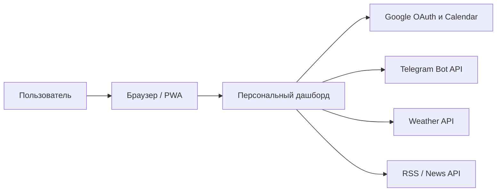
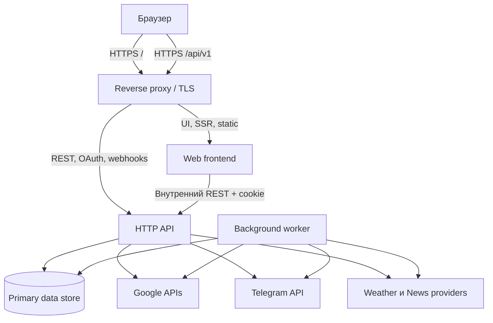
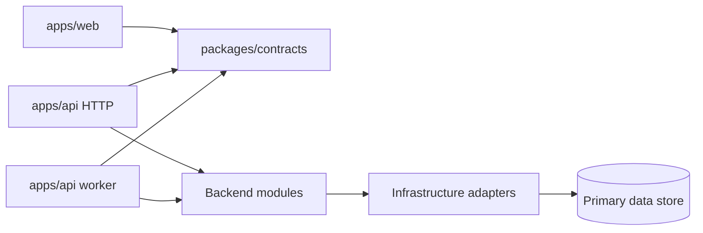
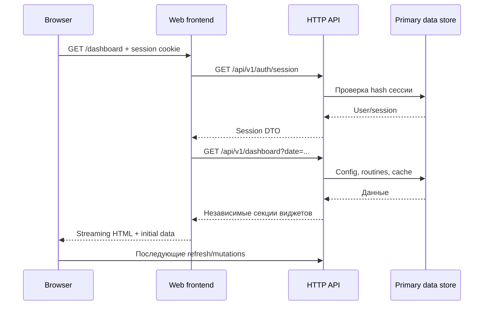
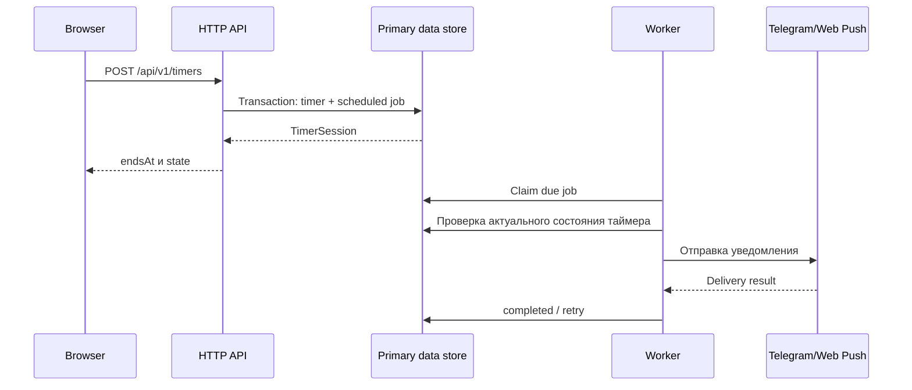
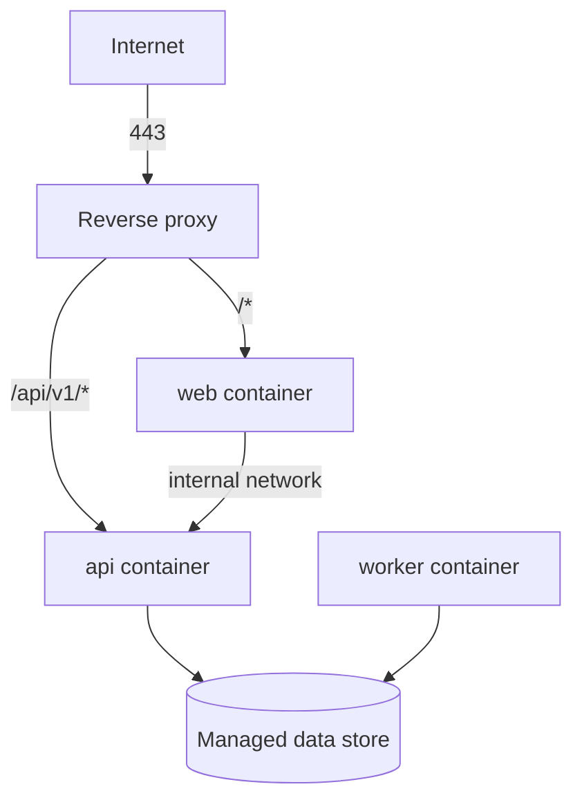

# Архитектура персонального дашборда

Версия: 1.0  
Статус: целевая архитектура MVP  
Основание: [TECHNICAL_SPECIFICATION.md](./TECHNICAL_SPECIFICATION.md)  
Технологический стандарт: [TECHNOLOGIES.md](./TECHNOLOGIES.md)

## 1. Архитектурное резюме

Приложение строится как monorepo и состоит из трёх независимо запускаемых процессов:

1. `web` — пользовательский интерфейс и серверный рендеринг.
2. `api` — HTTP API, OAuth callback и webhook.
3. `worker` — второй процесс из той же backend-кодовой базы для фоновых и отложенных задач.

Основное хранилище является единственным постоянным источником истины. Reverse proxy предоставляет единый публичный origin и направляет `/api/v1/*` в backend, а остальные запросы — во frontend.

Основной архитектурный стиль backend — модульный монолит. Это даёт явные границы между доменами без операционной сложности микросервисов.

Ключевые решения:

- один репозиторий и один lock-файл;
- независимые deploy artifacts для `web` и `api`;
- один backend-образ запускается двумя командами: API и worker;
- frontend не обращается к базе данных напрямую;
- бизнес-логика находится только в backend-модулях;
- frontend и backend используют общие API-контракты, но не общие модели БД;
- фоновые задачи на MVP хранятся в основном persistent store;
- production-развёртывание начинается с одного сервера и managed database;
- возможность горизонтального масштабирования сохраняется без сложной orchestration platform и микросервисов на старте.

Конкретные frameworks, библиотеки, версии и infrastructure tools перечислены только в [TECHNOLOGIES.md](./TECHNOLOGIES.md).

## 2. Контекст системы



Система не предоставляет внешним клиентам прямой доступ к базе данных или worker. Все пользовательские операции проходят через HTTP API.

## 3. Контейнерная схема



### Ответственность процессов

`web`:

- маршрутизация интерфейса;
- серверный и клиентский рендеринг;
- SSR и streaming;
- формы и пользовательские взаимодействия;
- локальные стили и темы;
- service worker для Web Push;
- вызовы HTTP API.

`api`:

- OAuth и сессии;
- REST API;
- валидация запросов;
- бизнес-операции;
- webhook Google и Telegram;
- доступ к постоянному хранилищу;
- постановка фоновых задач.

`worker`:

- выполнение отложенных уведомлений;
- завершение таймеров;
- синхронизация календаря;
- обновление AI-новостей;
- повторная доставка сообщений;
- очистка и восстановление зависших задач.

`Primary data store`:

- пользовательские и доменные данные;
- сессии и одноразовые токены;
- кэш внешних данных;
- очередь фоновых задач;
- идемпотентность уведомлений.

## 4. Структура репозитория

Рекомендуемая структура:

```text
dashboard/
├─ apps/
│  ├─ web/
│  │  ├─ public/
│  │  │  ├─ icons/
│  │  │  └─ sw.js
│  │  ├─ src/
│  │  │  ├─ app/
│  │  │  │  ├─ (public)/
│  │  │  │  │  ├─ login/
│  │  │  │  │  ├─ privacy/
│  │  │  │  │  └─ terms/
│  │  │  │  ├─ (protected)/
│  │  │  │  │  ├─ dashboard/
│  │  │  │  │  ├─ settings/
│  │  │  │  │  │  ├─ widgets/
│  │  │  │  │  │  ├─ routines/
│  │  │  │  │  │  ├─ integrations/
│  │  │  │  │  │  └─ profile/
│  │  │  │  │  └─ layout.tsx
│  │  │  │  ├─ error.tsx
│  │  │  │  ├─ global-error.tsx
│  │  │  │  ├─ layout.tsx
│  │  │  │  └─ not-found.tsx
│  │  │  ├─ features/
│  │  │  │  ├─ auth/
│  │  │  │  ├─ calendar/
│  │  │  │  ├─ dashboard/
│  │  │  │  ├─ news/
│  │  │  │  ├─ notifications/
│  │  │  │  ├─ routines/
│  │  │  │  ├─ timer/
│  │  │  │  ├─ weather/
│  │  │  │  └─ widget-settings/
│  │  │  ├─ components/
│  │  │  │  ├─ ui/
│  │  │  │  ├─ layout/
│  │  │  │  └─ feedback/
│  │  │  ├─ lib/
│  │  │  │  ├─ api/
│  │  │  │  ├─ auth/
│  │  │  │  ├─ browser/
│  │  │  │  └─ format/
│  │  │  ├─ providers/
│  │  │  └─ styles/
│  │  │     ├─ _breakpoints.scss
│  │  │     ├─ _mixins.scss
│  │  │     ├─ _tokens.scss
│  │  │     ├─ _typography.scss
│  │  │     └─ globals.scss
│  │  ├─ next.config.ts
│  │  ├─ package.json
│  │  └─ tsconfig.json
│  │
│  └─ api/
│     ├─ src/
│     │  ├─ main.ts
│     │  ├─ worker-main.ts
│     │  ├─ app/
│     │  │  ├─ create-app.ts
│     │  │  ├─ register-routes.ts
│     │  │  └─ shutdown.ts
│     │  ├─ config/
│     │  │  ├─ env.ts
│     │  │  └─ constants.ts
│     │  ├─ modules/
│     │  │  ├─ auth/
│     │  │  ├─ calendar/
│     │  │  ├─ dashboard/
│     │  │  ├─ integrations/
│     │  │  ├─ news/
│     │  │  ├─ notifications/
│     │  │  ├─ routines/
│     │  │  ├─ timer/
│     │  │  ├─ users/
│     │  │  ├─ weather/
│     │  │  └─ widgets/
│     │  ├─ infrastructure/
│     │  │  ├─ crypto/
│     │  │  ├─ http-clients/
│     │  │  ├─ jobs/
│     │  │  ├─ logging/
│     │  │  ├─ mongodb/
│     │  │  └─ push/
│     │  ├─ middleware/
│     │  ├─ shared/
│     │  │  ├─ errors/
│     │  │  ├─ types/
│     │  │  └─ utils/
│     │  └─ tests/
│     ├─ migrations/
│     ├─ package.json
│     └─ tsconfig.json
│
├─ packages/
│  ├─ contracts/
│  │  ├─ src/
│  │  │  ├─ auth/
│  │  │  ├─ common/
│  │  │  ├─ routines/
│  │  │  ├─ timer/
│  │  │  └─ widgets/
│  │  └─ package.json
│  └─ config/
│     ├─ eslint/
│     ├─ typescript/
│     └─ package.json
│
├─ infra/
│  ├─ docker/
│  │  ├─ web.Dockerfile
│  │  └─ api.Dockerfile
│  ├─ nginx/
│  │  └─ default.conf
│  ├─ compose.dev.yml
│  └─ compose.prod.yml
│
├─ scripts/
│  ├─ create-indexes.ts
│  └─ migrate.ts
├─ .env.example
├─ package.json
├─ package-lock.json
├─ TECHNICAL_SPECIFICATION.md
└─ architecture.md
```

### Почему worker находится внутри `apps/api`

API и worker используют одни и те же сервисы, repositories, интеграции и модели. Выделение отдельного `apps/worker` заставило бы либо дублировать код, либо преждевременно создавать большой общий backend-пакет.

Поэтому собирается один backend-образ, но запускается двумя командами:

```text
node dist/main.js
node dist/worker-main.js
```

Процессы остаются независимыми: их можно перезапускать и масштабировать отдельно.

## 5. Правила зависимостей

### 5.1. Общие правила

- `apps/web` не импортирует код из `apps/api`.
- `apps/api` не импортирует frontend-код.
- Оба приложения могут импортировать только публичные API из `packages/contracts` и `packages/config`.
- `packages/contracts` не зависит от UI, HTTP framework и реализации хранилища.
- Внутренние типы документов хранилища не публикуются во frontend.
- Секреты и server-only код не размещаются в общих пакетах.

Направление зависимостей:



### 5.2. Связи backend-модулей

- Route вызывает controller.
- Controller валидирует HTTP DTO и вызывает service.
- Service содержит бизнес-логику и вызывает repository/integration.
- Repository работает с одной или несколькими коллекциями своего модуля.
- Один модуль не обращается напрямую к repository другого модуля.
- Межмодульное взаимодействие выполняется через публичный service.
- Infrastructure реализует интерфейсы внешних зависимостей.

Допустимое направление:

```text
route → controller → service → repository → Primary data store
                           ↘ integration → External API
                           ↘ job queue → Persistent queue
```

Обратные импорты запрещены.

## 6. Frontend-архитектура

### 6.1. Маршрутизация и layouts

Папка `app` отвечает только за:

- URL и layouts;
- загрузку первичных данных;
- route-level loading/error/not-found states;
- composition feature-компонентов;
- metadata.

Большая бизнес-логика и сложные компоненты в `app` не размещаются.

Группы маршрутов:

- `(public)` — страницы без сессии;
- `(protected)` — маршруты, требующие авторизации.

Проверка защищённого layout выполняется на сервере через endpoint `GET /api/v1/auth/session`. Cookie входящего запроса пересылается во внутренний API. При отсутствии сессии выполняется server-side redirect на `/login`.

### 6.2. Серверные и клиентские компоненты

Серверные компоненты применяются для:

- layouts и страниц;
- первичной загрузки dashboard;
- чтения server-only переменных;
- уменьшения клиентского JavaScript.

Клиентские компоненты применяются только там, где нужны:

- клиентское состояние и обработчики событий;
- таймер;
- drag-and-drop;
- Geolocation API;
- Notification API;
- анимация погоды;
- optimistic UI.

Граница клиентских компонентов размещается как можно ниже по дереву. Конкретная директива определяется frontend-фреймворком из [TECHNOLOGIES.md](./TECHNOLOGIES.md).

### 6.3. Feature-first организация

Каждый домен во frontend имеет локальную структуру:

```text
features/routines/
├─ api/
├─ components/
├─ hooks/
├─ model/
├─ styles/
└─ index.ts
```

Правила:

- feature экспортирует только публичные элементы через `index.ts`;
- feature может импортировать `components/ui`, `lib` и `contracts`;
- прямые циклические импорты между features запрещены;
- объединение нескольких features выполняется на уровне страницы или dashboard composition;
- универсальный UI не должен знать о routines, timer или calendar.

### 6.4. Работа с API

В `src/lib/api` находятся два клиента:

- `server-api-client.ts` — работает внутри frontend server, использует `INTERNAL_API_URL` и пересылает cookie;
- `browser-api-client.ts` — использует относительные URL `/api/v1/*`.

Оба клиента:

- добавляют `requestId`, если он отсутствует;
- обрабатывают единый формат ошибок;
- проверяют ответ runtime-схемой из `packages/contracts`;
- не повторяют автоматически изменяющие запросы без idempotency key;
- поддерживают `AbortSignal` и timeout.

Первичная загрузка `/dashboard`:

1. Серверная страница вызывает агрегирующий endpoint.
2. Backend возвращает независимые секции виджетов.
3. Страница передаёт initial data клиентским виджетам.
4. Дальнейшие обновления и мутации идут из браузера напрямую в `/api/v1`.

Для MVP не требуется отдельная библиотека глобального server-state. Её следует добавить только при появлении повторяющейся логики кэширования, сложной пагинации или большого количества optimistic updates.

### 6.5. Стили

Обязательный подход:

- стили компонентов имеют локальную область видимости;
- глобальные стили содержат только reset, typography, themes и design tokens;
- runtime-тема использует semantic custom properties;
- inline styles допускаются только для действительно динамических числовых значений;
- конкретная технология стилей и правила синтаксиса определены в [TECHNOLOGIES.md](./TECHNOLOGIES.md).

Пример размещения:

```text
features/weather/components/WeatherWidget/
├─ WeatherWidget.tsx
├─ WeatherWidget.module.scss
├─ weather-animation.ts
└─ index.ts
```

Design tokens определяются один раз:

```text
styles/_tokens.scss      — compile-time style tokens
styles/globals.scss      — CSS variables для light/dark themes
```

### 6.6. Service worker

Service worker отвечает только за:

- получение Web Push;
- отображение browser notification;
- обработку перехода по уведомлению;
- кэширование минимального app shell при необходимости.

Он не является источником истины для таймера и не содержит бизнес-правила.

## 7. Backend-архитектура

### 7.1. Модульный монолит

Каждый доменный модуль имеет одинаковую форму:

```text
modules/routines/
├─ routine.routes.ts
├─ routine.controller.ts
├─ routine.service.ts
├─ routine.repository.ts
├─ routine.contracts.ts
├─ routine.types.ts
├─ routine.errors.ts
└─ routine.service.test.ts
```

Небольшой модуль может не создавать все файлы сразу. Деление выполняется по ответственности, а не ради количества слоёв.

### 7.2. HTTP pipeline

Порядок middleware:

1. trusted proxy configuration;
2. request ID;
3. structured access log;
4. security headers;
5. body size limits;
6. cookie parsing;
7. CORS — только если используется отдельный origin;
8. session/authentication;
9. CSRF/origin validation для мутаций;
10. rate limiting;
11. routes;
12. not-found handler;
13. centralized error handler.

`X-Powered-By` отключается. Значение `trust proxy` задаётся согласно реальному количеству доверенных прокси, а не глобальным `true`.

### 7.3. Формат API

Публичный префикс:

```text
/api/v1
```

Успешный единичный ответ:

```json
{
  "data": {},
  "meta": {
    "requestId": "..."
  }
}
```

Ошибка:

```json
{
  "error": {
    "code": "ROUTINE_NOT_FOUND",
    "message": "Рутина не найдена",
    "fieldErrors": {}
  },
  "meta": {
    "requestId": "..."
  }
}
```

Правила:

- JSON-поля API используют единое соглашение `camelCase`;
- даты-время передаются в ISO 8601 UTC;
- локальная дата передаётся как `YYYY-MM-DD`;
- pagination — cursor-based для растущих коллекций;
- `PATCH` используется для частичных изменений;
- повторяемые POST-запросы принимают `Idempotency-Key`;
- API не возвращает внутренний документ хранилища напрямую;
- DTO преобразуется явно в service/controller.

### 7.4. Общие контракты

`packages/contracts` содержит:

- runtime-схемы request/response;
- выведенные из схем статические типы;
- enum/union API-статусов;
- контракт ошибок;
- только сериализуемые DTO.

Контракты не содержат:

- внутренние идентификаторы и collection types;
- framework Request/Response;
- UI components;
- секреты или внутренние поля интеграций.

## 8. Хранилище данных

### 8.1. Подключение

- Каждый процесс создаёт один клиент хранилища.
- Внутри процесса используется общий connection pool.
- Клиент открывается при старте и закрывается при `SIGTERM`/`SIGINT`.
- API становится ready только после успешного подключения.
- На transient errors применяются ограниченные retries с exponential backoff.
- Запросы имеют ограничение максимального времени выполнения.

### 8.2. Коллекции

`users`:

- профиль, locale, timezone, тема;
- необязательное `weatherLocation`: широта и долгота, округлённые до двух знаков, и подпись места. Поле не входит в публичный профиль;
- индекс по внешним идентификаторам не хранится здесь.

`auth_accounts`:

- OAuth/Telegram identity;
- зашифрованные токены;
- unique `{ provider: 1, providerUserId: 1 }`;
- unique `{ userId: 1, provider: 1 }`.

`sessions`:

- hash session token, `userId`, `expiresAt`;
- unique по hash;
- TTL index только по `expiresAt` с `expireAfterSeconds: 0`.

`one_time_tokens`:

- одноразовый OAuth state, state календаря и ссылка Telegram: hash, назначение `oauth_state` | `calendar_oauth` | `telegram_link`, зашифрованный payload, `expiresAt`, `consumedAt`;
- пользователя в документе нет: идентификатор сессии лежит только внутри зашифрованного payload;
- unique по hash;
- TTL index по `expiresAt` с `expireAfterSeconds: 0`.

`dashboard_configs`:

- один документ на пользователя;
- небольшой ограниченный массив настроек виджетов;
- unique `{ userId: 1 }`;
- уникальность `{ userId, widgetType }` из спецификации держится одним документом и проверкой массива в приложении, отдельный индекс коллекции не создаётся;
- порядок и видимость обновляются атомарно одним документом.

`routine_rules`:

- шаблоны повторений;
- индекс `{ userId: 1, status: 1 }` по живым документам (`deletedAt: null`);
- индекс `{ userId: 1, startDate: 1 }` по живым документам (`deletedAt: null`).

`routine_occurrences`:

- состояние рутины на конкретную локальную дату;
- unique `{ routineRuleId: 1, localDate: 1 }`;
- индекс `{ userId: 1, localDate: 1 }`.

`timer_sessions`:

- история и текущая сессия;
- индекс `{ userId: 1, startedAt: -1 }`;
- partial unique `{ userId: 1 }` при `completedAt: null`: не больше одной незавершённой сессии.

`integrations`:

- Google Calendar и Telegram;
- credentials шифруются на уровне приложения;
- unique `{ userId: 1, type: 1 }` по живым документам (`deletedAt: null`).

`calendar_events`:

- нормализованный пользовательский кэш;
- unique `{ integrationId: 1, externalEventId: 1 }`;
- индекс `{ userId: 1, startAt: 1 }`.

`news_items`:

- глобальный кэш новостей;
- unique по hash канонического URL;
- индекс `{ publishedAt: -1, topics: 1, language: 1 }`.

`push_subscriptions`:

- Web Push endpoint и зашифрованные ключи;
- unique по hash endpoint;
- индекс `{ userId: 1, revokedAt: 1 }`.

`scheduled_jobs`:

- тип, payload, `runAt`, status, attempts;
- lease-поля `lockedAt`, `lockedBy`, `lockExpiresAt`;
- unique `idempotencyKey`;
- индекс `{ status: 1, runAt: 1 }`;
- отдельный TTL index по `deleteAt` для завершённых задач.

`notification_deliveries`:

- канал, status, attempts, provider message ID;
- unique `idempotencyKey`;
- индекс `{ userId: 1, createdAt: -1 }`;
- TTL index по `deleteAt` с `expireAfterSeconds: 0`: документ удаляется в записанный момент. Срок журнала доставки по умолчанию — 30 дней от `createdAt`. История таймеров и рутин не получает TTL и хранится до физической очистки аккаунта, см. раздел 8.9.

`audit_events`:

- события безопасности: вход, выход, привязка и отвязка интеграции, удаление аккаунта;
- в документе только `userId`, действие, цель (`google`, `google_calendar`, `telegram`) и даты. Токены, cookie, адреса и payload не пишутся;
- `userId` есть у событий живого аккаунта. После очистки аккаунта остаётся одна запись `account_deleted` с `userId: null`;
- индекс `{ userId: 1, createdAt: -1 }`;
- TTL по `deleteAt`, 90 дней от `createdAt`.

Ограничения TTL и compound indexes определяются возможностями выбранного хранилища из [TECHNOLOGIES.md](./TECHNOLOGIES.md).

### 8.3. Embedding и references

Встраиваются:

- небольшой ограниченный список widget preferences;
- настройки темы и локали пользователя;
- компактные значения timer preset.

Хранятся отдельно:

- история рутин;
- события календаря;
- новости;
- сессии;
- уведомления;
- фоновые задачи.

Неограниченно растущие массивы внутри `User` запрещены.

### 8.4. Транзакции

Транзакции используются только для операций, где требуется атомарное изменение нескольких документов:

- запуск таймера + создание scheduled job;
- критичное завершение OAuth-привязки;
- удаление интеграции + отмена связанных задач.

Обычные обновления одного документа используют атомарные операции хранилища без транзакции.

### 8.5. Шифрование credentials

Access token, refresh token, credentials интеграций и ключи Web Push шифруются в приложении до записи. Алгоритм — AES-256-GCM. Ключ — `DATA_ENCRYPTION_KEY`, 32 байта в base64 или hex, отдельно от MongoDB.

В поле хранится строка `enc:v1:<iv>.<tag>.<ciphertext>` в base64url. Дополнительные аутентифицированные данные привязаны к назначению поля: `auth_accounts.access_token`, `auth_accounts.refresh_token`, `integrations.credentials`, `push_subscriptions.keys`, `one_time_tokens.payload`. Ciphertext одного поля нельзя подставить в другое. Открытый секрет в базу и логи не попадает.

### 8.6. Мягкое удаление

`users`, `routine_rules` и `integrations` при пользовательском удалении не стираются физически. Операция ставит `deletedAt` и `updatedAt`. Повтор идемпотентен. Undo снова записывает `deletedAt: null`, пока живой документ с тем же уникальным ключом не занял место.

Выборки живых документов фильтруют `deletedAt: null`. Физическая очистка аккаунта описана в разделе 8.9.

### 8.7. Версионированные миграции

Миграции лежат в `apps/api/src/infrastructure/mongodb/migrations`. Номера сплошные, начиная с 1. `up` идемпотентен. Команда `npm run db:migrate --workspace @dashboard/api` применяет только ещё не записанные версии и фиксирует их в `schema_migrations` (`version`, `name`, `appliedAt`). Уникальный индекс по `version` не даёт применить одну версию дважды.

Первая миграция создаёт коллекции с валидаторами и индексы каталога на момент запуска. Вторая миграция `one-time-tokens` идемпотентно добавляет `one_time_tokens` для баз, которые уже применили версию 1. Третья миграция `external-adapters` добавляет `calendar_events`, необязательное `users.weatherLocation` и назначения `calendar_oauth` и `telegram_link` у `one_time_tokens`. Четвёртая миграция `background-jobs` создаёт `scheduled_jobs`, обновляет валидаторы `users` и `integrations` и добавляет индексы очереди, срока таймера, напоминаний рутин, отозванных push-подписок и подключённых интеграций. Пятая миграция `security-audit` создаёт `audit_events` и её индексы. Новая миграция не удаляет поля в том же выпуске, где код перестаёт их читать.

### 8.8. Проверка запросов

Основные чтения сессии, дашборда, рутин, таймера, новостей, интеграций и уведомлений собраны в каталоге запросов. У каждого unique- и query-индекса есть один запрос. Команда `npm run db:check --workspace @dashboard/api` выполняет `explain` с `executionStats`.

План принимается, только если победивший план читает ожидаемый индекс (`IXSCAN`), не сканирует коллекцию целиком и не сортирует отдельно там, где порядок уже задан индексом. Запросы к частичным индексам включают их фильтр: `deletedAt: null` или `completedAt: null`.

На коллекции меньше 32 документов планировщик может честно выбрать полный просмотр. Тогда проверка отдельно подтверждает, что заданный индекс способен выполнить запрос. Начиная с 32 документов должен победить сам индекс.

### 8.9. Целостность, очистка аккаунта и сроки хранения

Проверка целостности сверяет ссылки и не загружает секреты: в выборку попадают только идентификаторы, тип и позиция виджета, даты журнала доставки.

Нарушением считается:

- документ пользовательской коллекции ссылается на отсутствующего пользователя;
- экземпляр рутины ссылается на отсутствующее правило или на правило другого пользователя;
- в настройках дашборда повторяются тип или позиция виджета;
- у записи `notification_deliveries` нет `deleteAt` либо срок не равен 30 дням от `createdAt`;
- событие календаря ссылается на отсутствующую интеграцию или на интеграцию другого пользователя.

Сроки:

- `sessions` удаляет TTL по `expiresAt`;
- `one_time_tokens` удаляет TTL по `expiresAt` и не принадлежит пользователю;
- журнал доставки живёт 30 дней;
- журнал аудита живёт 90 дней;
- завершённые и проваленные задачи очереди удаляет TTL по `scheduled_jobs.deleteAt`;
- `timer_sessions`, `routine_rules`, `routine_occurrences` и `calendar_events` живут до очистки аккаунта. TTL на них не ставится.

`purgeAccount` в одной транзакции удаляет пользователя и документы с его `userId` из `auth_accounts`, `sessions`, `dashboard_configs`, `routine_rules`, `routine_occurrences`, `timer_sessions`, `integrations`, `calendar_events`, `push_subscriptions`, `notification_deliveries`, `scheduled_jobs` и `audit_events`. Задачи без пользователя (`userId: null`) — lock планировщика и heartbeat — не удаляются. Запись `account_deleted` с пустым `userId` тоже остаётся и удаляется только TTL. `news_items` — общий кэш, он не удаляется. `one_time_tokens` тоже не удаляется: срок жизни задаёт TTL. Живой аккаунт (`deletedAt: null`) не удаляется. Повтор после очистки ничего не стирает.

`DELETE /api/v1/account` вызывает очистку только для пользователя текущей сессии и только после мягкого удаления. Если очистка не удалась, мягкое удаление возвращается, а клиент получает 503. Отдельной команды очистки в CLI нет.

## 9. Фоновые задачи

### 9.1. Persistent queue на MVP

Очередь использует основное persistent store, чтобы не добавлять отдельный инфраструктурный сервис до появления измеримой необходимости. Выбор текущей и возможной будущей реализации зафиксирован в [TECHNOLOGIES.md](./TECHNOLOGIES.md).

Взаимодействие скрывается за интерфейсом `JobQueue`, поэтому реализацию можно заменить без изменения доменных сервисов.

### 9.2. Получение задачи worker

Worker атомарно захватывает следующую доступную задачу:

- выбирает `pending` задачу с `runAt <= now`;
- устанавливает `status = processing`;
- записывает `lockedBy` и срок lease;
- возвращает захваченный документ.

После выполнения:

- успех → `completed`;
- временная ошибка → новый `runAt` с exponential backoff;
- превышение retries → `failed`;
- завершённый документ получает `deleteAt`.

Если worker завершился аварийно, задача с истёкшим lease возвращается в `pending`.

### 9.3. Идемпотентность

Каждая доставляемая операция имеет стабильный `idempotencyKey`, например:

```text
timer:{timerSessionId}:work-completed:telegram
```

Unique index не позволяет создать повторную доставку. Внешний вызов и его результат фиксируются в `notification_deliveries`.

### 9.4. Периодические задачи

- AI-новости — каждые 15 минут;
- продление Calendar watch channels — по сроку expiration;
- восстановительная Calendar sync — по расписанию;
- поиск истёкших таймеров — короткий интервал как страховочный механизм;
- очистка отозванных подписок — ежедневно;
- возврат задач с истёкшим lease — постоянно;
- проверка reminder рутин — согласно локальному времени пользователя.

Периодические задачи используют распределённый lock в основном хранилище, чтобы при нескольких worker только один создавал очередную партию.

## 10. Основные потоки данных

### 10.1. Открытие dashboard



Endpoint dashboard использует `Promise.allSettled` для независимых источников. Ошибка календаря не превращает весь ответ в 500.

### 10.2. Запуск таймера



Клиент отображает оставшееся время как `endsAt - now`. Worker, а не вкладка браузера, отвечает за гарантированное уведомление.

### 10.3. Google Calendar

1. Пользователь начинает подключение через backend.
2. Backend создаёт `state`/PKCE и перенаправляет в Google.
3. Callback приходит в backend.
4. Credentials шифруются и сохраняются в `integrations`. Scope — только `calendar.readonly`, отдельно от входа.
5. Callback и `POST /api/v1/calendar/sync` делают ограниченную синхронизацию: не больше трёх страниц по 50 событий. Истёкший `syncToken` (ответ 410) сбрасывается, после чего читается видимое окно.
6. Нормализованные события лежат в `calendar_events`. Dashboard читает только этот кэш.
7. `POST /api/v1/webhooks/google-calendar` проверяет `X-Goog-Channel-Token` и только ставит `sync-calendar` в очередь. Состояние `sync` — рукопожатие, задачу не создаёт. Worker синхронизирует календарь и за 15 минут до начала события ставит напоминание. Если заданы `GOOGLE_CALENDAR_WEBHOOK_URL` и `GOOGLE_CALENDAR_WEBHOOK_TOKEN`, ежедневная задача продлевает канал, который истекает в ближайшие сутки.

### 10.4. Погода

1. Browser получает координаты после согласия.
2. Backend округляет их до двух знаков и хранит в `users.weatherLocation`. В публичный профиль координаты не попадают.
3. Ключ кэша строится по округлённым координатам и единице температуры.
4. Свежий ответ живёт 15 минут в памяти процесса. Отдельной коллекции погоды нет.
5. Если Open-Meteo недоступен, отдаётся устаревший снимок не старше 6 часов. Иначе секция получает статус ошибки и не роняет дашборд.

### 10.5. AI-новости

1. `GET /api/v1/news` читает `news_items`. Если общий кэш старше 15 минут, API обновляет его из разрешённых RSS/Atom-лент.
2. Загрузка идёт только на allowlist-хосты, без следования редиректам. У каждого хоста свой предохранитель.
3. Adapter убирает HTML, нормализует URL, убирает дубли и назначает темы.
4. Новости upsert-ятся в `news_items` по hash канонического URL.
5. API фильтрует готовую коллекцию по языку, теме, лимиту и режиму источников. Если обновление не удалось, остаётся прошлый снимок. Worker дополнительно обновляет ленту каждые 15 минут.

## 11. Авторизация и сессия

Backend полностью владеет авторизацией.

Cookie:

- имя `__Host-session`;
- `HttpOnly`;
- `Secure` всегда, включая localhost;
- `SameSite=Lax`;
- `Path=/`;
- без `Domain`.

В cookie хранится случайный session token. Постоянное хранилище содержит только его SHA-256 hash. Срок сессии — 14 суток и не продлевается при запросах. Выход отзывает только текущую сессию.

Google OAuth использует scopes `openid email profile`, PKCE, `state` и `nonce`. `state` живёт 10 минут, расходуется один раз, а payload шифруется. Callback принимает только `code`, `state`, `error`, `error_description`, `iss` и `scope` и всегда перенаправляет на фиксированный путь приложения.

OAuth state входа, state календаря и одноразовая ссылка Telegram хранятся в `one_time_tokens`. В базе лежит только hash, payload шифруется. Recovery token по-прежнему не создаётся. `POST /api/v1/webhooks/telegram` проверяет `X-Telegram-Bot-Api-Secret-Token` и завершает ссылку по команде `/start`. Одноразовые токены:

- короткоживущие;
- хранятся в виде hash;
- автоматически удаляются TTL index.

Для мутаций с cookie backend проверяет, что `Origin` равен `APP_ORIGIN`, и заголовок `X-CSRF-Token`. Токен — HMAC сырого session token на `SESSION_SECRET`. `GET /api/v1/auth/google`, `GET /api/v1/auth/google/callback` и `GET /api/v1/integrations/google/callback` CSRF не требуют: это переход браузера, а адрес возврата не берётся из запроса. Внешние webhook имеют отдельные правила.

Эндпоинты входа и профиля:

- `GET /health/live`, `GET /health/ready`;
- `GET /api/v1/auth/google`, `GET /api/v1/auth/google/callback`;
- `GET /api/v1/integrations/google/callback`;
- `GET /api/v1/auth/session`;
- `POST /api/v1/auth/logout`;
- `GET /api/v1/profile`, `PATCH /api/v1/profile`;
- `DELETE /api/v1/account`.

Профиль не содержит идентификатор пользователя в пути. Каждое чтение и изменение фильтруется идентификатором текущей сессии.

## 12. Развёртывание

### 12.1. Локальная разработка

Локально запускаются:

- frontend dev server;
- HTTP API с watch mode;
- worker с watch mode;
- локальный кластер хранилища через `compose.dev.yml`.

Reverse proxy в локальной разработке необязателен. Frontend dev server может проксировать `/api/v1` в backend, чтобы browser продолжал работать с same-origin URL.

Корневые команды разработки, сборки и тестирования определены в package manifest; выбранный package manager указан в [TECHNOLOGIES.md](./TECHNOLOGIES.md).

### 12.2. Production на одном сервере

Оптимальный MVP-вариант:

- один Linux-сервер;
- container runtime с declarative compose-конфигурацией;
- reverse proxy;
- managed database;
- один контейнер `web`;
- один контейнер `api`;
- один контейнер `worker`.



База данных не разворачивается на том же сервере в production, если доступен managed-вариант: резервное копирование, отказоустойчивость и обновления не должны обслуживаться приложением.

### 12.3. Frontend image

Multi-stage build формирует автономный runtime artifact и копирует только production server, статические assets и public-файлы.

Контейнер запускает runtime entrypoint под непривилегированным пользователем.

### 12.4. Backend image

Один multi-stage container build:

1. устанавливает workspace dependencies;
2. компилирует backend и contracts;
3. копирует production dependencies и `dist`;
4. запускается под непривилегированным пользователем.

Один image используется сервисами:

```text
api:    node dist/main.js
worker: node dist/worker-main.js
```

Это гарантирует, что API и worker используют одну версию доменного кода.

### 12.5. Reverse proxy

Reverse proxy:

- завершает TLS;
- ограничивает body size;
- добавляет базовый rate limit;
- перенаправляет `/api/v1` в backend;
- перенаправляет остальные запросы во frontend;
- передаёт `X-Forwarded-*`;
- не буферизует streaming-ответы frontend;
- не публикует внутренние порты контейнеров.

Backend доверяет только известному reverse proxy.

### 12.6. Health checks и shutdown

API:

- `/health/live` — процесс работает;
- `/health/ready` — хранилище доступно, конфигурация валидна.

Web:

- lightweight health endpoint без пользовательских данных.

Worker:

- периодически обновляет heartbeat;
- readiness означает подключение к хранилищу;
- мониторинг проверяет возраст heartbeat.

При `SIGTERM`:

1. API перестаёт принимать новые подключения.
2. Завершает in-flight requests.
3. Worker перестаёт брать новые задачи.
4. Активная задача завершается или освобождает lease.
5. Клиент хранилища закрывается.
6. Процесс завершается до истечения grace period.

Для frontend server предусматривается drain period 10–30 секунд.

## 13. Переменные окружения

Корневой `.env.example` содержит только имена и безопасные примеры.

`web`:

- `NODE_ENV`;
- `INTERNAL_API_URL`;
- `NEXT_PUBLIC_APP_URL`;
- `DEPLOYMENT_VERSION`;
- `NEXT_SERVER_ACTIONS_ENCRYPTION_KEY` — при нескольких web-инстансах.

`api` и `worker`:

- `NODE_ENV`;
- `PORT`;
- `APP_ORIGIN`;
- `MONGODB_URI`;
- `MONGODB_DB_NAME`;
- `SESSION_SECRET`;
- `DATA_ENCRYPTION_KEY`;
- `GOOGLE_CLIENT_ID`;
- `GOOGLE_CLIENT_SECRET`;
- `GOOGLE_REDIRECT_URI`;
- `TELEGRAM_BOT_TOKEN`;
- `TELEGRAM_WEBHOOK_SECRET`;
- `WEB_PUSH_PUBLIC_KEY`;
- `WEB_PUSH_PRIVATE_KEY`;
- provider keys для погоды/новостей;
- настройки retries, lease и retention.

Секреты:

- не имеют префикса `NEXT_PUBLIC_`;
- не включаются в image;
- передаются при запуске;
- в production хранятся в secret storage хостинга или защищённом env-файле вне репозитория.

## 14. CI/CD

Pipeline:

1. checkout;
2. воспроизводимая установка по lock-файлу;
3. lint;
4. статическая проверка типов;
5. unit tests;
6. integration tests с production-совместимым кластером хранилища;
7. build contracts, API и web;
8. E2E для критичных сценариев;
9. сборка versioned container images;
10. security/dependency scan;
11. публикация images;
12. запуск migration/index scripts;
13. обновление Compose services;
14. health checks;
15. автоматический rollback при неуспешном health check.

Container images помечаются immutable tag по commit SHA. `latest` не используется как единственный production tag.

Миграции хранилища:

- имеют номер версии;
- идемпотентны;
- записываются в `schema_migrations`;
- отдельно создают/проверяют индексы;
- не удаляют поля в том же deployment, где код перестаёт их читать.

## 15. Наблюдаемость

### Логи

- структурированный JSON в stdout;
- `requestId`, `userId` при наличии, route, status, duration;
- job ID, job type, attempt и duration;
- токены, cookies, координаты и payload webhook редактируются;
- stack trace доступен только в server logs.

### Метрики

- HTTP request rate/error rate/latency;
- latency операций хранилища и pool saturation;
- размер очереди по status;
- возраст самой старой pending job;
- успешность Web Push и Telegram;
- длительность Calendar sync;
- freshness новостей и погоды;
- worker heartbeat.

### Ошибки

Frontend и backend используют единый release/version identifier. Ошибка должна связываться с `requestId` и deployment version.

## 16. Безопасность сети и данных

- TLS обязателен.
- API и web доступны снаружи только через reverse proxy.
- Хранилище разрешает подключение только от production-сервера/закрытой сети.
- Все внешние HTTP-клиенты имеют timeout, ограничение ответа и allowlist hosts.
- RSS HTML не вставляется в DOM напрямую.
- Refresh tokens и push keys шифруются authenticated encryption.
- Ключ шифрования отделён от хранилища.
- Webhook проверяет секрет/подпись до чтения бизнес-payload.
- Rate limit различается для входа, одноразовых ссылок интеграций, API, webhook и `/metrics`. `/health/live` и `/health/ready` не ограничиваются: это проверки процесса.
- В production включаются CSP, HSTS и ограничивающая Permissions Policy.

## 17. Тестовая архитектура

`web`:

- unit tests утилит;
- component tests интерактивных виджетов;
- accessibility tests;
- E2E пользовательских сценариев.

`api`:

- unit tests services с in-memory fakes интерфейсов;
- repository integration tests с production-совместимым хранилищем;
- HTTP integration tests через backend app без открытия внешнего порта;
- contract tests request/response;
- adapter tests с записанными безопасными fixtures.

`worker`:

- claim/lease/retry;
- идемпотентность;
- восстановление зависших задач;
- fake clock для таймеров и расписаний.

Критичные E2E:

- вход/выход;
- настройка виджетов;
- CRUD рутин;
- таймер и доставка уведомления;
- подключение/отзыв Calendar;
- отказ одного внешнего провайдера.

## 18. Масштабирование без преждевременного усложнения

### Этап 1. MVP

- 1 web;
- 1 API;
- 1 worker;
- managed database;
- persistent job queue в основном хранилище;
- один сервер и compose-конфигурация.

### Этап 2. Рост нагрузки

- несколько API-контейнеров за proxy;
- несколько worker с lease;
- CDN для immutable frontend assets;
- отдельный shared cache/queue только при подтверждённой необходимости;
- общий cache handler, если web масштабируется горизонтально и используется server cache.

### Этап 3. Значительный рост

- отдельные worker pools по типам задач;
- managed queue;
- read replicas/увеличение tier хранилища;
- отдельный сервис новостей только если его нагрузка и цикл релиза действительно отличаются;
- orchestration platform только при недостаточности Compose.

Конкретные отложенные технологии перечислены в [TECHNOLOGIES.md](./TECHNOLOGIES.md). Распределённая архитектура не внедряется заранее.

## 19. Архитектурные ограничения

Запрещено:

- обращаться к базе данных из frontend;
- размещать бизнес-логику в UI components;
- создавать второй доменный backend внутри frontend-приложения;
- вызывать внешний API из браузера с секретным ключом;
- использовать внутренние документы хранилища как API DTO;
- создавать неограниченные массивы в пользовательском документе;
- запускать таймеры через долгоживущий `setTimeout` как источник истины;
- выполнять тяжёлую работу внутри webhook;
- добавлять отдельный cache/queue service, брокер сообщений или микросервис без измеримой причины;
- импортировать backend-код во frontend через workspace.

## 20. Принятые архитектурные решения

### ADR-001: модульный монолит

Выбран вместо микросервисов. Причина: небольшая команда, единый продукт, общая БД и необходимость быстрого развёртывания.

### ADR-002: same-origin через reverse proxy

Выбран для упрощения cookie-auth, CORS, CSRF и production URL.

### ADR-003: API и worker из одного backend-image

Выбрано для повторного использования доменной логики при независимом runtime-масштабировании.

### ADR-004: Persistent job queue в основном хранилище

Выбрана для уменьшения числа инфраструктурных компонентов. Скрывается за интерфейсом и может быть заменена внешней очередью.

### ADR-005: API contracts отдельно от DB models

Выбрано для безопасной эволюции схемы хранилища и предотвращения утечки внутренних полей.

## 21. Порядок создания архитектуры в коде

1. Подготовить frontend workspace в `apps/web`.
2. Настроить корневые workspaces и общие lint/type configs.
3. Добавить `packages/contracts`.
4. Создать backend app factory, health endpoints и error middleware.
5. Подключить единый storage client и repository infrastructure.
6. Реализовать auth/session end-to-end.
7. Реализовать `dashboard_configs` и базовый dashboard.
8. Добавить routines и timer.
9. Добавить `scheduled_jobs` и worker.
10. Подключать внешние интеграции по одной.
11. Добавить container builds, reverse proxy и production compose.
12. Настроить CI/CD, мониторинг и backup-проверки.

## 22. Источники

- [Технологии проекта](./TECHNOLOGIES.md)
- [Google Calendar API: Synchronize resources](https://developers.google.com/workspace/calendar/api/guides/sync)

